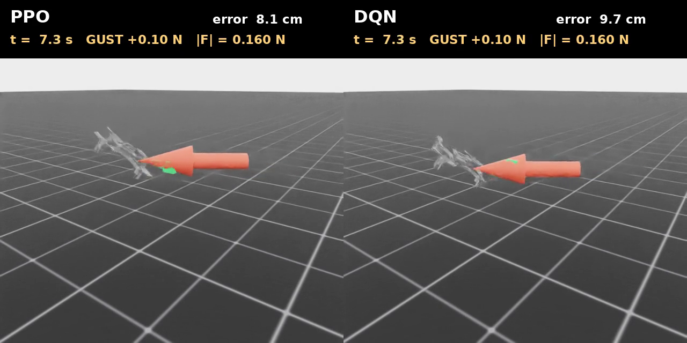
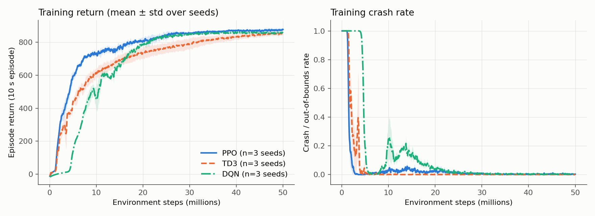

# Drone Stable Hover RL

Deep reinforcement learning for wind-resistant quadrotor hovering: PPO vs TD3 vs DQN on a Crazyflie 2.x in
**Isaac Sim 4.5 / Isaac Lab 2.1**, compared under one shared environment, one wind model and one evaluation protocol.

> **2026-11 re-run.** The original 2025 code trained each algorithm in a *different* environment (DQN: 9-D state and
> no wind; TD3: Stable-Baselines3 with its own reward; PPO: 18-D state with 0.2–0.4 N wind applied in the body frame),
> and the previously reported "recovery time" was actually the episode duration (`steps × 0.01 s`, capped at 3.0 s).
> Those numbers are therefore **superseded**. Everything below was regenerated with the unified pipeline in
> [`hover_rl/`](hover_rl/); the original scripts are kept in `PPO/`, `TD3/`, `DQN/` for reference (see
> [Legacy code](#legacy-code)).

## Results (3 seeds × 50 M steps per algorithm)



[`media/ppo_vs_dqn_wind.mp4`](media/ppo_vs_dqn_wind.mp4) — PPO (left) and DQN (right), seed 0, same scripted wind:
0–3 s no wind, 3 s base wind 0.06 N, 7 s gust +0.10 N in the same direction for 0.5 s (0.16 N ≈ 58 % of the
drone's weight in total). Red arrow = wind force, green cube = target. In this clip the peak deviation during the
gust is 9.7 cm for PPO and 14.2 cm for DQN.

Protocol: 512 episodes/model, eval seed 1000, 12 s episodes, base wind U[0.02, 0.08] N (drone weight 0.277 N), gust pulse +0.10 N for 0.5 s at 6 s. Recovery band 5 cm held 0.5 s; success = no crash and last-2 s error < 10 cm. Mean ± std across 3 training seeds.

| Algorithm | Position error (cm) | Gust peak error (cm) | Recovery time (s) | Success rate | Crash rate |
|---|---|---|---|---|---|
| PPO | 1.13 ± 0.24 | 7.1 ± 0.3 | 0.54 ± 0.04 | 99.7 ± 0.2% | 0.3% |
| TD3 | 1.84 ± 0.24 | 7.5 ± 0.2 | 0.62 ± 0.04 | 100.0 ± 0.0% | 0.0% |
| DQN | 0.80 ± 0.14 | 8.4 ± 0.1 | 0.63 ± 0.01 | 100.0 ± 0.0% | 0.0% |

Beyond the training range (base wind fixed, same gust pulse) — success rate / crash rate:

| Algorithm | 0.10 N (36 % weight) | 0.12 N (43 % weight) | 0.14 N (51 % weight) |
|---|---|---|---|
| PPO | 99.0% / 1.0% | 89.5% / 9.2% | 48.8% / 44.1% |
| TD3 | 96.9% / 2.2% | 79.8% / 14.1% | 42.8% / 37.6% |
| DQN | 99.6% / 0.4% | 80.5% / 13.5% | 10.4% / 56.2% |

- PPO relative to DQN: position error +41%, gust peak error -16%, recovery time -14% (negative = PPO better)
- PPO relative to TD3: position error -39%, gust peak error -5%, recovery time -13% (negative = PPO better)

**Reading the numbers**

- Inside the training wind range all three methods hover reliably (≥ 99.7 % success). DQN has the smallest steady
  error (0.8 cm) — its 81-action bang-bang policy dithers around the target very tightly once trained.
- PPO handles disturbances best: lowest gust peak error (7.1 cm), fastest recovery into the 5 cm band (0.54 s,
  14 % faster than DQN, 13 % faster than TD3), and the most graceful degradation beyond the training range
  (89.5 % success at 0.12 N vs ~80 % for TD3/DQN; 48.8 % at 0.14 N vs 10.4 % for DQN).
- TD3 is the most conservative: zero crashes in range but the largest steady error (1.8 cm).




### Compared with the 2025 version

| | 2025 README | This re-run |
|---|---|---|
| Environment | three different environments, wind 0.2–0.4 N in the body frame (README said 0.5–2.0 N) | one shared Isaac Lab env, world-frame wind 0.02–0.08 N + gusts, calibrated thrust, yaw torque |
| Evaluation | not reproducible from the repo | 3 seeds × 512 episodes, fixed seeds, script included |
| Hover success (PPO / TD3 / DQN) | 85 % / 70 % / 45 % | 99.7 % / 100 % / 100 % |
| "Recovery time" (PPO / TD3 / DQN) | 2.5 / 3.8 / 5.2 s — actually episode duration, capped at 3 s | 0.54 / 0.62 / 0.63 s from gust onset into a 5 cm band |
| Position error (PPO) | "within 0.3 m under 2.0 N" | 1.1 cm steady, 7.1 cm peak during a +0.10 N gust |

The 2025 numbers cannot be reproduced from the 2025 code and are not comparable metric-for-metric; the table is only
meant to show what changed.

### What was tuned

Everything below applies to all three algorithms unless noted (same environment, same budget, same protocol):

1. **Physics fixes** — thrust coefficient calibrated (5000 RPM = hover), wind applied in the world frame, rotor
   reaction torque added so yaw is controllable.
2. **Observation** — body-frame 18-D state with the gravity direction instead of Euler angles. In single-seed pilots
   this took PPO from 15 % to 0.2 % crashes and from 4.2 cm to 1.2 cm error once random headings were introduced.
3. **Training distribution** — random gust pulses during training (without them a +0.15 N evaluation gust crashed
   98 % of PPO episodes in an early pilot).
4. **Scale** — 1024 parallel environments, 50 M steps per run (the 2025 code ran one drone at a time).
5. **DQN** — Double DQN + 3-step returns, low update ratio, lr 1e-4, τ 0.001 (see the tuning note below); the
   original-style settings diverged.


## Task and environment (`hover_rl/env.py`)

| Item | Setting |
|---|---|
| Simulator | Isaac Sim 4.5, Isaac Lab 2.1 `DirectRLEnv`, 1024 Crazyflies simulated in parallel on the GPU |
| Robot | Crazyflie 2.x (`isaaclab_assets.CRAZYFLIE_CFG`), mass 28.2 g, weight 0.277 N |
| Goal | hover at (0, 0, 1) m; start uniformly within ±0.2 m of the goal, level, at rest, random yaw |
| Control rate | physics 100 Hz, policy 50 Hz (dt = 0.02 s) |
| Episode | 10 s (500 policy steps) in training; 12 s in evaluation |
| Termination | z < 0.2 m, z > 1.5 m, or \|x\|, \|y\| > 1.0 m |

**State (18-D):** position (3), target position (3), gravity direction in the body frame (3), body-frame linear
velocity (3), body-frame angular velocity (3), body-frame position error (3). All algorithms use the same 18-D state
and the same running observation normaliser. (The 2025 version used roll/pitch/yaw and world-frame velocities; with
a random initial heading, the yaw wrap-around at ±π and the heading-dependent world-frame inputs raised PPO's crash
rate from ~1 % to 15 % in a pilot run, so attitude is now encoded as the gravity direction, as in Isaac Lab's own
quadcopter task.)

**Action (4-D):** one command per motor in [-1, 1] → RPM in [4500, 5500]; thrust = k_f·ω² on each propeller.
k_f is calibrated so that 5000 RPM on all motors exactly balances gravity, so the motors can produce 0.81–1.21× the
drone's weight. (The original code used k_f = 1e-6, which made even the minimum RPM produce 3.4× the weight.)
Each rotor also produces a reaction torque about the body z axis (k_m/k_f = 0.025 m, alternating spin directions),
which the original code omitted. Without it yaw is uncontrollable: in a first run without this torque, yaw drifted
through gyroscopic coupling and ~1.5 % of PPO episodes flipped over during the first 3 s.
DQN needs discrete actions: each motor takes one of 3 levels {4500, 5000, 5500} RPM → 3⁴ = 81 joint actions.

**Wind (world frame, horizontal):**
- base wind: strength ~ U[0.02, 0.08] N (7–29 % of the weight), random direction, re-drawn every episode;
- gusty variation: every 1 s the strength is scaled by 1 + U(−0.2, 0.2) and the direction jittered by ±0.1 rad;
- gust pulses (training only): Poisson rate 0.3 Hz, extra U[0.03, 0.10] N in a random direction for U[0.2, 0.5] s.

The force is converted to the body frame before it is applied (Isaac Lab external wrenches are body-frame; the
original code applied the "wind" in the body frame directly, so it rotated with the drone). With the thrust limit of
1.21× weight, the largest horizontal force the drone can hold against while keeping altitude is ≈ 0.68× weight
≈ 0.19 N, which is why the wind range is expressed in tens of millinewtons rather than the 0.5–2.0 N previously
written in this README (2 N would be 7× the drone's weight).

**Reward (shared):** `1 − tanh(d / 0.3) + exp(−d² / 0.005) − 0.05‖v‖² − 0.02‖ω‖²` per step, where d is the distance to
the goal (max 2 per step, ≤ 1000 per 10 s episode).

## Algorithms (`hover_rl/algos.py`)

| | PPO | TD3 | DQN |
|---|---|---|---|
| Action space | continuous, Gaussian | continuous, deterministic + noise | 81 discrete motor-level combinations |
| Networks | actor/critic MLP 256-128-64 (ELU) | actor + twin critics MLP 256-256 | Q-network MLP 256-256 |
| Data | 1024 envs × 32-step rollouts | 1024 envs → 2 M replay buffer | 1024 envs → 2 M replay buffer |
| Update | 5 epochs × 4 minibatches, clip 0.2, GAE λ 0.95, adaptive LR (KL target 0.01) | 8 gradient steps of batch 4096 per vector step, policy delay 2, target noise 0.2 | Double DQN + 3-step returns, 2 gradient steps of batch 4096 per vector step, Huber loss, ε 1 → 0.05 over 6 M steps |
| γ / LR | 0.99 / 3e-4 (adaptive) | 0.99 / 3e-4, τ 0.005 | 0.99 / 1e-4, τ 0.001 |

DQN tuning note: with the TD3-style update ratio (8 gradient steps per vector step), lr 3e-4, τ 0.005 and 1-step
targets, DQN diverged (Q-loss → 10⁶ after ~8 M steps). Lowering the update ratio and adding 3-step returns made it
learn (0.06 m error at 10 M steps) but it still collapsed at ~11 M steps (Q-loss growing from 1 to 3000). The final
setting — additionally lr 1e-4 and a slower target network (τ 0.001) — trained stably; snapshots every 5 M steps are
kept in `runs/dqn_s*/snapshots/` so any late collapse would be visible.

Every algorithm gets the same budget: **50 M environment steps, 3 training seeds (0, 1, 2)**. The *final* policy of
each run is evaluated (no best-checkpoint picking).

## Evaluation protocol (`hover_rl/evaluate.py`)

Deterministic policies, 512 parallel 12 s episodes per trained model, fixed evaluation seed 1000.

- 0–6 s: base wind ~ U[0.02, 0.08] N with gusty variation (random training gusts switched off).
- 6 s: **gust pulse** — an extra 0.10 N (36 % of the weight) in a random horizontal direction for 0.5 s.
- **Position error**: mean ‖p − p*‖ over 2–6 s (steady wind, initial transient excluded).
- **Recovery time**: time from gust onset until the error is < 0.05 m and stays there for 0.5 s (6 s window, no 3 s
  cap). Episodes that never recover are reported as the *recovered* rate, not averaged in.
  (A 0.10 m band was too loose: the best policies never leave it after the gust.)
- **Success**: no crash / out-of-bounds during the whole 12 s **and** mean error over the last 2 s < 0.10 m.
- **Wind sweep**: the same episode with base wind fixed to 0, 0.02, …, 0.14 N (0.10–0.14 N is beyond the training
  range).

Per-model results are averaged over the 512 episodes; the tables report mean ± std across the 3 training seeds.

## Reproduce

```bash
# 1. Isaac Sim 4.5 + Isaac Lab 2.1 in a venv (Python 3.10, ~15 GB)
python3 -m venv ~/workspace/isaaclab-env && source ~/workspace/isaaclab-env/bin/activate
pip install torch==2.5.1 torchvision==0.20.1 --index-url https://download.pytorch.org/whl/cu121
pip install "isaacsim[all,extscache]==4.5.0" --extra-index-url https://pypi.nvidia.com
git clone --branch v2.1.0 https://github.com/isaac-sim/IsaacLab.git && cd IsaacLab
pip install "setuptools<70" && pip install --no-build-isolation flatdict==4.0.1 && ./isaaclab.sh --install none

# 2. train 3 algorithms x 3 seeds, evaluate, write tables and figures (~3.5 h on one RTX 3080 Ti)
cd Drone-Stable-Hover-RL
bash hover_rl/run_all.sh

# single run / evaluation / report / video
hover_rl/run.sh hover_rl/train.py --algo ppo --seed 0 --env_steps 50000000
hover_rl/run.sh hover_rl/evaluate.py
python hover_rl/report.py
hover_rl/run.sh hover_rl/record.py --model runs/ppo_s0/model.pt --algo ppo --label PPO --out media/ppo_s0_wind.mp4
```

`hover_rl/run.sh` activates the venv, clears ROS `PYTHONPATH` entries and sets `OMNI_KIT_ACCEPT_EULA=YES` (running it
means you accept the NVIDIA Omniverse License Agreement).

Outputs: `runs/<algo>_s<seed>/{train_log.csv, config.json, model.pt}`, `results/{eval_per_model.json, summary.md,
summary.csv}`, `figures/{training_curves.png, wind_adaptation.png}`.

## Project structure

```
Drone-Stable-Hover-RL/
├── hover_rl/            # unified pipeline (source of all numbers in this README)
│   ├── env.py           # Isaac Lab wind-hover environment
│   ├── algos.py         # PPO / TD3 / DQN
│   ├── train.py         # one algorithm, one seed
│   ├── evaluate.py      # evaluation protocol + wind sweep
│   ├── report.py        # tables and figures
│   ├── record.py        # headless camera recording of a policy under scripted wind
│   ├── run.sh           # venv wrapper
│   └── run_all.sh       # full experiment
├── runs/                # training logs + configs (model weights are git-ignored)
├── results/             # evaluation JSON + summary tables
├── figures/             # training_curves.png, wind_adaptation.png
├── media/               # ppo_vs_dqn_wind.mp4 (+ single clips) and poster frames
├── PPO/ TD3/ DQN/       # legacy 2025 scripts (not used for the results)
└── visualization.py     # legacy
```

## Legacy code

The 2025 scripts are kept unchanged in behaviour except for three labelling fixes:
`PPO/read_training_data_PPO.py` now labels the x-axis "Wind Force (N)" (it was "Wind Speed (m/s)"),
`PPO/drone_PPO_record.py` documents that its "recovery time" is really the episode duration and uses the control
time step, and `DQN/drone_DQN.py` documents its 9-D state. The old figures in `PPO/figure/` and data in `PPO/data/`
come from that legacy setup (2000 training episodes, rewards ≈ +1600 under the old `10·exp(−10 d²)` reward) and are
not comparable with the results above.

## Contact

- GitHub: [NUSNiuMu](https://github.com/NUSNiuMu)
