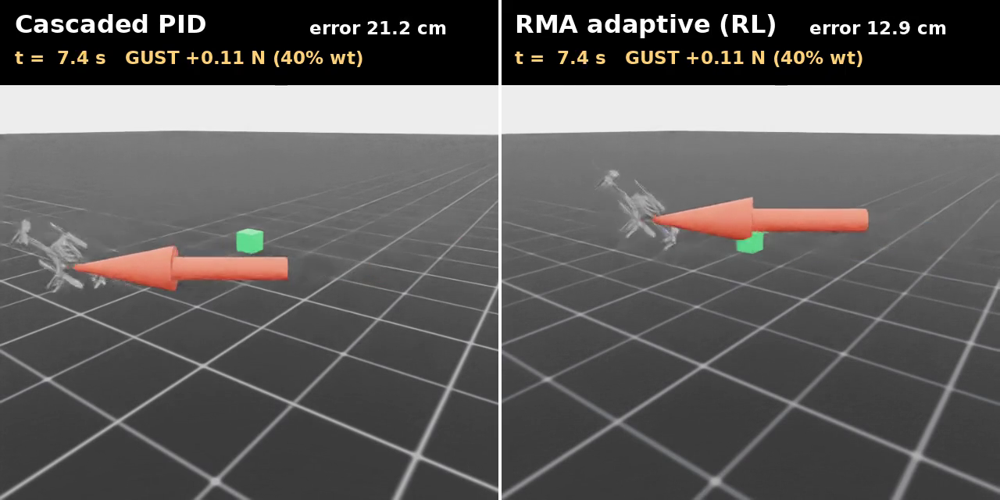
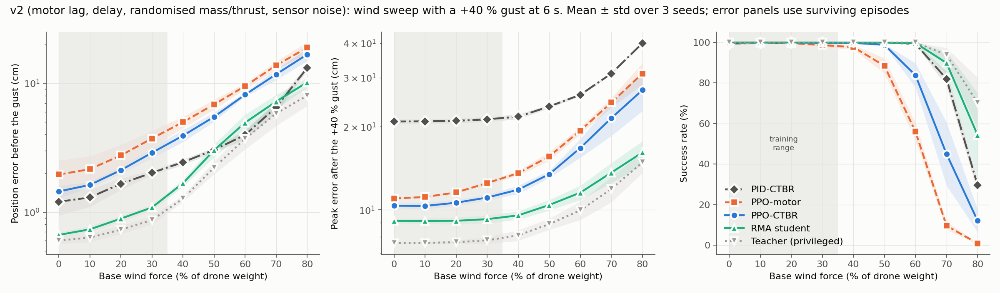
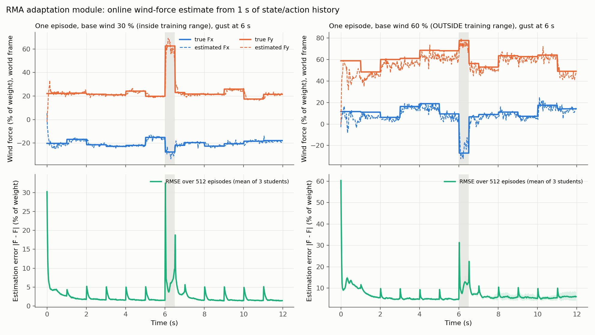
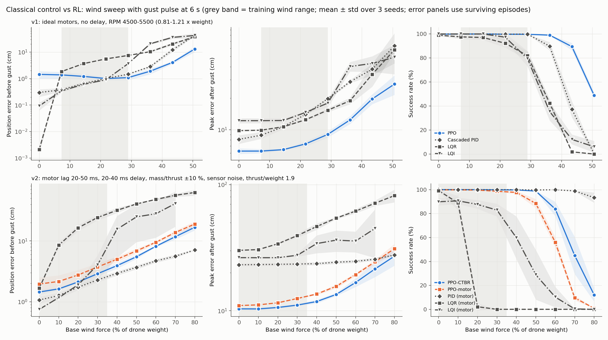
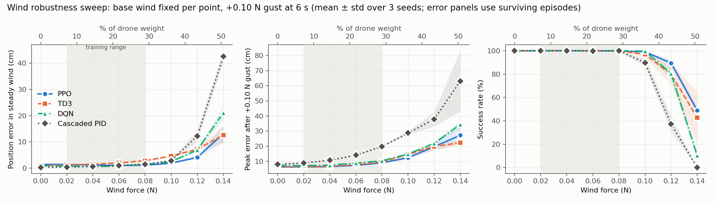

# Wind-Resistant Hover Controller Design (Drone Stable Hover RL)

Which controller should hold a Crazyflie-class quadrotor at a point in gusty wind — a hand-tuned **cascaded PID**,
an **LQR / LQI**, or a **reinforcement-learning** policy (PPO, TD3, DQN, and an **RMA-style wind-adaptive
teacher–student** policy)? Every controller is tuned or trained on its own seeds and evaluated with one protocol in
**Isaac Sim 4.5 / Isaac Lab 2.1**, first in an idealised simulator (v1), then in a more realistic one (v2: motor lag,
command delay, randomised mass/thrust, sensor noise, real thrust-to-weight ratio). Conclusions are reported as
measured, including where RL loses.



[`media/v2_pid_vs_rma_wind.mp4`](media/v2_pid_vs_rma_wind.mp4) — v2 simulator, cascaded PID (left) vs RMA adaptive
RL policy (right), same scripted wind: 0–3 s calm, 3 s steady wind of 50 % of the drone's weight (already outside the
RL training range of 0–35 %), 7 s an extra 40 % gust in the same direction for 0.5 s (90 % of the weight in total).
Red arrow = wind force, green cube = target. Peak deviation during the gust: PID 29.7 cm, RMA policy 13.6 cm (same seed, airframe and sensor noise).

## Key findings

**Realistic simulator (v2), inside the training wind range (0–35 % of weight + 40 % gust):**

- The **RMA adaptive policy is the best deployable controller on every in-range metric**: 0.90 cm steady error,
  9.2 cm gust peak, 0.84 s recovery — vs the cascaded PID's 1.66 cm / 21.0 cm / 1.58 s
  (−46 % / −56 % / −47 %) and plain PPO's 2.15 cm / 10.6 cm / 1.09 s (−58 % / −13 % / −23 %).
- Its learned wind estimator tracks the true wind force with 2 % (of weight) RMSE in steady wind (correlation 0.994)
  and is within 17 % of a teacher that is *given* the true wind.
- **CTBR beats direct motor commands for RL** (PPO: −24 % steady error, −19 % recovery time, far better beyond range).
- **LQR/LQI are the most fragile under realistic actuation**: the unmodelled motor lag and delay cost LQI 14 % crashes;
  LQR without integral action keeps a 15 cm offset (randomised mass/thrust and steady wind are constant disturbances).

**Where RL loses:**

- **Strong wind beyond the training range: the cascaded PID is the most robust controller.** At a steady 80 % of the
  weight + gust, PID (motor output) still succeeds in 93 % of episodes, RMA 54 %, PPO-CTBR 12 %, PPO-motor 1 %. The
  learned policies were trained on 0–35 % wind and do not extrapolate the way an integrator does.
- **Steady-state precision in the idealised v1 simulator:** PID (0.81 cm) and DQN (0.80 cm) beat PPO (1.13 cm).
- **TD3 did not transfer to the realistic simulator** with the v1 hyper-parameters: no crashes, but a ~10 cm hover
  offset, 54 % success in range and 0 % at ≥ 40 % wind (3 seeds × 100 M steps; it was not re-tuned).
- RL needs 100 M simulated steps (~1 h on a GPU per seed); the PID is 8 numbers tuned in ~10 minutes.

## Methods at a glance

| Method | Full name / idea | How it works here | Input → output | Key hyper-parameters | Source |
|---|---|---|---|---|---|
| **Cascaded PID** | Proportional–integral–derivative, nested loops | Position PID → desired thrust vector (tilt limited) → tilt-prioritised attitude P → body-rate P → mixer; the standard structure of PX4 / Crazyflie firmware | measured position, velocity, attitude, gyro → 4 motor commands (or thrust + body rates in CTBR) | kp/kd/ki for xy and z, k_att, k_rate (8 gains, CEM-tuned per environment) | Crazyflie firmware `controller_pid`; PX4 multicopter control architecture; Brescianini & D'Andrea 2018 (tilt-prioritised attitude) |
| **LQR** | Linear–quadratic regulator | Hover linearisation (12-state small-angle model in the heading frame, nominal mass/inertia), ZOH-discretised at 50 Hz, discrete Riccati solution; position error clipped (anti-saturation) | same 12-D state → collective thrust + 3 torques → mixer → motors | Bryson's-rule maxima for Q/R (10 values) + error clip, CEM-tuned | Kalman 1960; Bryson & Ho 1975; Bouabdallah et al. 2004 (PID vs LQ on a micro quadrotor) |
| **LQI** | LQR with integral action | LQR augmented with the integral of the position error (3 extra states), conditional integration as anti-wind-up | state + ∫position error → thrust + torques | as LQR + 2 integral maxima | standard servo/integral LQR (e.g. MATLAB `lqi`) |
| **PPO** | Proximal Policy Optimization | On-policy actor-critic, clipped surrogate, GAE, adaptive LR on KL | observation (18-D v1 / 26-D v2) → 4 actions | 1024 envs × 32 steps, 5 epochs × 4 minibatches, clip 0.2, γ 0.99, λ 0.95, MLP 256-128-64 | Schulman et al. 2017 |
| **TD3** | Twin Delayed DDPG | Off-policy deterministic actor, twin critics, target smoothing, delayed actor updates | same → 4 actions | 2 M replay, batch 4096, 8 updates/step, policy delay 2, τ 0.005, MLP 256-256 | Fujimoto et al. 2018 |
| **DQN** | Deep Q-Network (Double DQN, 3-step returns) | Discrete Q-learning over 3 levels per motor (81 joint actions) | same → 1 of 81 motor-level combinations | lr 1e-4, τ 0.001, 2 updates/step, ε 1→0.05 | Mnih et al. 2015; van Hasselt et al. 2016; Hessel et al. 2018 |
| **CTBR action space** | Collective thrust + body rates | Policy outputs total thrust and 3 body-rate set-points; an onboard 100 Hz P rate loop + mixer (shared with the PID-CTBR) turns them into motor commands | observation → [T, ω_x, ω_y, ω_z] | rate gain 20 / 20 / 10 s⁻¹, max rate 4 / 4 / 2 rad/s | Kaufmann et al. 2022 (benchmark of learned quadrotor control interfaces) |
| **RMA teacher–student** | Rapid Motor Adaptation | Teacher = PPO-CTBR that also sees privileged e = [wind force in body frame, mass, thrust coeff., motor τ, delay]; student = frozen teacher + adaptation module estimating ê from the last 1 s (50 steps) of observations and actions, trained by on-policy regression (DAgger-style) | 50 × 26-D history → ê (7-D) → teacher → 4 CTBR actions | MLP 1300-256-128-7, 30 M steps, MSE in normalised e space | Kumar et al. 2021 (RMA); related: O'Connell et al. 2022 (Neural-Fly) |

All controllers see the same (noisy, in v2) measurements; only the RMA teacher sees privileged information and is
reported as an upper bound, not as a deployable controller.

## Results

All numbers: 512 evaluation episodes per controller, evaluation seed 1000, 12 s episodes, base wind in the training
range with a random direction, plus one gust pulse at 6 s (0.5 s). Mean ± std over 3 seeds — training seeds for RL,
independent tuning seeds (11, 12, 13) for PID/LQR/LQI. *Position error* = mean true distance to the target over 2–6 s;
*gust peak* = max error after the gust; *recovery* = time from gust onset until the error stays < 5 cm for 0.5 s;
*success* = no crash in 12 s and last-2 s error < 10 cm.

### v2 — realistic simulator (main result)

Thrust-to-weight 1.9; motor lag τ ~ U[20, 50] ms; 1–2 step (20–40 ms) command delay; mass and thrust coefficient ±10 %;
sensor noise (5 mm, 2 cm/s, 0.01 rad, 0.05 rad/s); base wind U[0, 35] % of the weight; gust +40 %.

| Controller | Position error (cm) | Gust peak (cm) | Recovery (s) | Success | Crash |
|---|---|---|---|---|---|
| Cascaded PID (CTBR, onboard rate loop) | 1.66 ± 0.17 | 21.0 ± 0.4 | 1.58 ± 0.04 | 99.9 % | 0.1 % |
| Cascaded PID (motor commands) | 1.73 ± 0.17 | 23.4 ± 0.6 | 1.94 ± 0.19 | 100.0 % | 0.0 % |
| LQR (motor commands) | 14.72 ± 1.61 | 33.5 ± 0.5 | 1.81 ± 0.30 | 35.3 % | 0.8 % |
| LQI (motor commands) | 2.27 ± 0.57 | 27.0 ± 0.3 | 1.76 ± 0.05 | 84.8 % | 14.4 % |
| PPO, motor commands | 2.83 ± 0.54 | 11.6 ± 0.2 | 1.35 ± 0.06 | 99.5 % | 0.5 % |
| PPO, CTBR | 2.15 ± 0.13 | 10.6 ± 0.3 | 1.09 ± 0.04 | 100.0 % | 0.0 % |
| TD3, CTBR (v1 hyper-parameters) | 9.90 ± 1.40 | 19.7 ± 0.6 | 1.91 ± 0.21 ¹ | 54.4 % | 0.0 % |
| **RMA student (CTBR, estimates wind online)** | **0.90 ± 0.05** | **9.2 ± 0.2** | **0.84 ± 0.06** | **100.0 %** | **0.0 %** |
| RMA teacher (sees the true wind — upper bound) | 0.74 ± 0.06 | 7.7 ± 0.1 | 0.80 ± 0.03 | 100.0 % | 0.0 % |

Success with the steady wind fixed **beyond the training range** (same +40 % gust):

| Controller | 40 % wt | 50 % wt | 60 % wt | 70 % wt | 80 % wt |
|---|---|---|---|---|---|
| PID-CTBR | 99.9 % | 99.9 % | 99.3 % | 82.0 % | 29.6 % |
| **PID-motor** | **100.0 %** | **99.7 %** | **99.9 %** | **99.0 %** | **93.4 %** |
| LQR | 0.0 % | 0.0 % | 0.0 % | 0.0 % | 0.0 % |
| LQI | 59.8 % | 28.8 % | 10.2 % | 0.3 % | 0.0 % |
| PPO-motor | 97.7 % | 88.5 % | 56.0 % | 9.6 % | 0.8 % |
| PPO-CTBR | 99.8 % | 98.8 % | 83.9 % | 45.0 % | 12.0 % |
| TD3-CTBR | 0.0 % | 0.0 % | 0.0 % | 0.0 % | 0.0 % |
| RMA student | 100.0 % | 99.9 % | 99.7 % | 89.9 % | 54.3 % |
| RMA teacher | 100.0 % | 100.0 % | 100.0 % | 93.9 % | 70.2 % |

¹ only 16.5 % of TD3 episodes get back inside 5 cm at all; the mean is over those. TD3 does not crash in range,
but it hovers with a ~10 cm offset (success 36–70 % per seed) and already fails at a steady 30 % wind (2–10 %).

(LQR "success" is 0 although it rarely crashes at 40–60 %: without integral action its steady offset exceeds the
10 cm success threshold.) Full tables incl. crash rates: [`results_v2/summary.md`](results_v2/summary.md).



**Online wind estimation (RMA adaptation module).** RMSE of the estimated wind force, in % of the weight, over 512
episodes and 3 students: 2.0 (steady, base wind 30 %, inside the range), 5.2 (steady, 60 %, outside the range,
estimate biased 2.7 % low), 9–13 during the 0.5 s gust (the 1 s history window lags a step change by ~0.1–0.2 s).
Correlation between estimated and true x/y force: 0.994.



### v1 — idealised simulator

Ideal motors (no lag, no delay, no noise, no randomisation); motor speed limited to 4500–5500 RPM (0.81–1.21 × weight);
base wind 0.02–0.08 N (7–29 % of the weight); gust +0.10 N (36 %).

| Controller | Position error (cm) | Gust peak (cm) | Recovery (s) | Success | Crash |
|---|---|---|---|---|---|
| PPO | 1.13 ± 0.24 | **7.1 ± 0.3** | **0.54 ± 0.04** | 99.7 % | 0.3 % |
| TD3 | 1.84 ± 0.24 | 7.5 ± 0.2 | 0.62 ± 0.04 | 100.0 % | 0.0 % |
| DQN | **0.80 ± 0.14** | 8.4 ± 0.1 | 0.63 ± 0.01 | 100.0 % | 0.0 % |
| Cascaded PID | 0.81 ± 0.05 | 13.2 ± 0.3 | 1.10 ± 0.02 | 99.7 % | 0.3 % |
| LQR | 4.65 ± 0.07 | 11.6 ± 0.1 | 1.22 ± 0.01 | 94.3 % | 5.5 % |
| LQI | 1.06 ± 0.04 | 13.7 ± 0.8 | 1.35 ± 0.23 | 96.5 % | 2.9 % |

Success beyond the training range: at 0.12 N (43 % of weight) PPO 89.5 %, TD3 79.8 %, DQN 80.5 %, PID 37.2 %,
LQR 1.8 %, LQI 12.2 %; at 0.14 N (51 %) 48.8 / 42.8 / 10.4 / 0.1 / 0.0 / 6.1 %
([`results/summary.md`](results/summary.md)). With only 21 % thrust margin, every controller saturates the motors
here; the RL policies, trained with random gusts at saturation, handle it best.





## Questions answered with the data

**Why a cascaded PID as the baseline?** It is what flies real quadrotors: PX4 and the Crazyflie firmware both use
cascaded position → attitude → rate PID loops, so "does RL beat the PID?" is the question a practitioner asks. It
also turned out to be a strong baseline once tuned properly (CEM over 8 gains, 3 independent tuning seeds that agree
within a few %): in v1 its steady error (0.81 cm) ties the best RL policy, and in v2 it is the most robust controller in
very strong wind.

**LQR / LQI vs PID — where LQR wins and loses.**
- *Wins:* in v1 (perfect model, no delay) LQR has a lower gust peak than the PID (11.6 vs 13.2 cm): full-state feedback
  uses velocity and attitude jointly and reacts faster to a disturbance. LQI matches the PID's steady error
  (1.06 vs 0.81 cm) once integral action is added.
- *Loses — constant disturbances:* plain LQR has no integrator, so steady wind and (in v2) the randomised mass/thrust
  leave a constant offset: 4.65 cm in v1 and 14.7 cm in v2, vs 0.81 / 1.73 cm for the PID. LQI removes it
  (1.06 / 2.27 cm).
- *Loses — saturation:* a linear law has no notion of motor limits. Without the error clip, LQR/LQI crashed after the
  initial offset and after gusts; even with it (and conditional integration), LQR/LQI crash 3–6 % of v1 episodes and
  fall to 0–12 % success at 43 % wind, vs 37 % for the PID with its explicit tilt limit.
- *Loses — model error and delay:* the LQR model omits motor lag and command delay. In v2 LQI loses most of its
  margin (84.8 % success, 14.4 % crashes; PID 100 %), and beyond the training range it collapses (10 % at 60 % wind vs
  99.9 % for the PID). A PID's low-gain, loop-by-loop structure tolerates the unmodelled 20–90 ms of lag much better.

**RL vs PID and LQR — advantages and disadvantages.**
- *Advantages:* RL is far better at rejecting gusts: in v2 the RMA policy's gust peak is 9.2 cm vs 21.0 cm (PID) and
  27.0 cm (LQI), recovery 0.84 s vs 1.58 s / 1.76 s; in v1 PPO halves the PID's peak (7.1 vs 13.2 cm) and recovery
  time (0.54 vs 1.10 s). RL learns to use the full actuator range near saturation (v1 beyond-range success
  89.5 % vs 37.2 % at 43 % wind), and with RMA it identifies the wind online and reaches the best steady error
  (0.90 cm vs PID 1.66 cm in v2).
- *Disadvantages:* RL only works where it was trained: in v2 beyond 60 % wind the PID-motor keeps 93–99 % success while
  PPO falls to 1–12 % and RMA to 54 %. RL needs a simulator, ~100 M steps per seed and careful design choices
  (observation, action interface, randomisation, reward); TD3 with the v1 hyper-parameters failed in v2. A PID is
  8 interpretable gains that tune in minutes and come with well-understood stability margins.

### Which conclusions hold, which do not

| Claim | Holds? | Evidence |
|---|---|---|
| RL rejects gusts better than PID/LQR (peak error, recovery time) | **Yes**, in v1 and v2 | v1 PPO 7.1 vs PID 13.2 cm; v2 RMA 9.2 vs PID 21.0 cm, 0.84 vs 1.58 s |
| RL has the best steady hover precision | **Only with adaptation (v2)** | v2 RMA 0.90 cm best; plain PPO is worse than PID (2.15 vs 1.66 cm); v1 PID ≈ DQN < PPO |
| RL is more robust to strong wind than PID | **No** (v2) / yes (v1, saturation-limited) | v2 at 80 % wind: PID-motor 93 %, RMA 54 %, PPO 12 %; v1 at 43 %: PPO 89.5 %, PID 37 % |
| Wind-aware adaptation (RMA) improves on plain RL | **Yes** | steady −58 %, peak −13 %, recovery −23 %; 80 % wind success 54.3 % vs 12.0 % |
| The learned estimator really estimates the wind | **Yes** | RMSE 2 % of weight in range, correlation 0.994 |
| CTBR is a better RL action space than motor commands | **Yes** (PPO) | −24 % steady error, −19 % recovery, 45 % vs 9.6 % success at 70 % wind |
| LQR is better than PID | **No** | better gust peak only in the idealised v1; worse offset, saturation and delay robustness |
| TD3 is competitive | **Yes** (v1) / **No** (v2) | v1: 100 % success, peak 7.5 cm; v2: 9.9 cm offset, 54 % success, 0 % at ≥ 40 % wind |

## Environments (`hover_rl/env.py`, `hover_rl/presets.py`)

Shared: Crazyflie 2.x (28.2 g, weight 0.277 N), target (0, 0, 1) m, start within ±0.2 m, random yaw, physics 100 Hz,
control 50 Hz, 10 s training episodes, termination below 0.2 m / above 1.5 m / beyond ±1 m. Wind is a horizontal force in
the world frame with gusty variation (±20 % every second) and Poisson gust pulses during training.

| | v1 (idealised) | v2 (realistic) |
|---|---|---|
| Actuation | motor RPM 4500–5500 (0.81–1.21 × weight), instantaneous | thrust-to-weight 1.9 (Crazyflie 2.1), first-order motor lag τ ~ U[20, 50] ms |
| Delay | none | 1–2 control steps (20–40 ms) |
| Randomisation | none | mass/inertia ×U[0.9, 1.1], thrust coefficient ×U[0.9, 1.1] |
| Sensor noise | none | position 5 mm, velocity 2 cm/s, attitude 0.01 rad, gyro 0.05 rad/s |
| Observation | 18-D body-frame state | 18-D + last 2 actions (26-D) |
| Action interfaces | 4 motor commands | 4 motor commands, or CTBR with an onboard 100 Hz rate loop |
| Wind (training) | 0.02–0.08 N (7–29 %) + gusts 0.03–0.10 N | 0–35 % of weight + gusts 10–40 % |
| Evaluation gust | +0.10 N (36 %) | +40 % |
| Reward | `1 − tanh(d/0.3) + exp(−d²/0.005) − 0.05‖v‖² − 0.02‖ω‖²` | same − 0.01‖Δa‖² |

The RMA teacher additionally observes the 7-D privileged vector. The v1 environment is unchanged from the 2026-11
re-run (its RL numbers reproduce to 1e-8).

## Training and tuning budget

| | v1 | v2 |
|---|---|---|
| PPO / TD3 / DQN | 3 seeds × 50 M steps each | PPO motor, PPO CTBR, RMA teacher, TD3 CTBR: 3 seeds × 100 M steps; RMA student: 30 M steps per teacher |
| PID / LQR / LQI | CEM, 1024 parallel episodes per iteration (PID 20, LQR/LQI 30 iterations), tuning seeds 11–13, 8 s episodes with a gust at 4 s; never the evaluation seed | same |

DQN was not re-trained in v2: 3 discrete levels per motor cannot express the wider thrust range and the CTBR set-points
without redesigning its action set, and in v1 it already had the weakest gust rejection of the three RL algorithms.
TD3 was re-trained once with its v1 hyper-parameters and not tuned further.

Tuning notes for the classical controllers (so the comparison is fair): LQR/LQI first used a plain Riccati solve over
the raw Q/R (numerically failed for wide weight ranges) → solved in Bryson-normalised coordinates; started from a
physically reasonable Bryson guess instead of mid-range; clipped the position error (tuned) like the PID's tilt limit;
LQI uses conditional integration. Each step removed crashes that were artefacts of the implementation, not of LQR.

## Evaluation protocol (`hover_rl/evaluate.py`)

Deterministic policies; 512 parallel episodes of 12 s; evaluation seed 1000; random training gusts off; base wind
~ U[training range] with a random direction; gust pulse at 6 s for 0.5 s in a random direction; errors use the true
position (not the noisy measurement). The wind sweep repeats the episode with the base wind fixed (v1: 0–0.14 N;
v2: 0–80 % of the weight). In v2 all controllers of one action interface run on the same episodes (the environment
exposes the privileged vector; non-teacher controllers ignore it).

## Reproduce

```bash
# Isaac Sim 4.5 + Isaac Lab 2.1 in a venv (Python 3.10, ~15 GB)
python3 -m venv ~/workspace/isaaclab-env && source ~/workspace/isaaclab-env/bin/activate
pip install torch==2.5.1 torchvision==0.20.1 --index-url https://download.pytorch.org/whl/cu121
pip install "isaacsim[all,extscache]==4.5.0" --extra-index-url https://pypi.nvidia.com
git clone --branch v2.1.0 https://github.com/isaac-sim/IsaacLab.git && cd IsaacLab
pip install "setuptools<70" && pip install --no-build-isolation flatdict==4.0.1 && ./isaaclab.sh --install none

cd Drone-Stable-Hover-RL
bash hover_rl/run_all.sh          # v1: PPO/TD3/DQN x 3 seeds
bash hover_rl/tune_all_pid.sh     # PID / LQR / LQI, v1 and v2, tuning seeds 11-13
bash hover_rl/run_v2.sh           # v2: PPO-motor, PPO-CTBR, RMA teacher x 3 seeds
bash hover_rl/run_students.sh     # v2: RMA students (adaptation modules)
bash hover_rl/run_td3_v2.sh       # v2: TD3-CTBR
hover_rl/run.sh hover_rl/evaluate.py --preset v1
hover_rl/run.sh hover_rl/evaluate.py --preset v2_ctbr_priv  --out results_v2
hover_rl/run.sh hover_rl/evaluate.py --preset v2_motor_priv --out results_v2
hover_rl/run.sh hover_rl/wind_estimate.py --students runs_v2/student_ctbr_s*/student.pt
python hover_rl/report.py && python hover_rl/report_v2.py
hover_rl/run.sh hover_rl/record.py --preset v2_ctbr_priv --algo student --model runs_v2/student_ctbr_s0/student.pt \
    --base_n 0.5 --gust_n 0.4 --label "RMA" --out media/v2_rma_wind.mp4
```

`hover_rl/run.sh` activates the venv, clears ROS `PYTHONPATH` entries and sets `OMNI_KIT_ACCEPT_EULA=YES` (running it
means you accept the NVIDIA Omniverse License Agreement). On a 12 GB GPU at most three Isaac Sim processes fit at once.

## Project structure

```
Drone-Stable-Hover-RL/
├── hover_rl/
│   ├── env.py            # Isaac Lab wind-hover environment (v1 defaults + v2 realism options)
│   ├── presets.py        # v1 / v2_motor / v2_ctbr (+ _priv) configurations
│   ├── algos.py          # PPO / TD3 / DQN
│   ├── control.py        # cascaded PID, LQR/LQI, RMA student, controller loading
│   ├── train.py          # RL training (one algorithm, one seed, one preset)
│   ├── train_student.py  # RMA phase 2 (adaptation module)
│   ├── tune_pid.py       # CEM tuning of PID / LQR / LQI
│   ├── evaluate.py       # evaluation protocol + wind sweep (all controllers)
│   ├── wind_estimate.py  # RMA estimated vs true wind
│   ├── report.py         # v1 tables + figures
│   ├── report_v2.py      # v2 tables + figures, classical-vs-RL figure
│   ├── record.py         # headless camera recording under scripted wind
│   └── run*.sh, tune_all_pid.sh
├── baselines/            # tuned PID / LQR / LQI parameters (JSON) + tuning logs
├── runs/, runs_v2/       # training logs + configs (weights are git-ignored)
├── results/, results_v2/ # evaluation JSON + summary tables
├── figures/              # all figures
├── media/                # videos and poster frames
└── PPO/ TD3/ DQN/        # legacy 2025 scripts (not used for any number above)
```

## History

- **2025** — original PPO/TD3/DQN scripts (`PPO/`, `TD3/`, `DQN/`). Each algorithm used a different environment and the
  reported "recovery time" was the episode duration; those numbers are superseded.
- **2026-11 re-run** — one shared Isaac Lab environment and protocol for PPO/TD3/DQN (v1 above; video
  [`media/ppo_vs_dqn_wind.mp4`](media/ppo_vs_dqn_wind.mp4)).
- **2026-11 controller study** (this version) — PID/LQR/LQI baselines, realistic v2 simulator, CTBR, RMA adaptation.

The legacy scripts carry only labelling fixes (wind axis in N, "recovery time" documented as episode duration, DQN's
9-D state documented); their figures and data come from the old setup and are not comparable.

## References

Bouabdallah, Noth, Siegwart, *PID vs LQ control techniques applied to an indoor micro quadrotor*, IROS 2004 ·
Brescianini, D'Andrea, *Tilt-prioritized quadrocopter attitude control*, IEEE TCST 2018 ·
Bryson, Ho, *Applied Optimal Control*, 1975 ·
Fujimoto, van Hoof, Meger, *Addressing function approximation error in actor-critic methods* (TD3), ICML 2018 ·
Hessel et al., *Rainbow*, AAAI 2018 ·
Kaufmann et al., *A benchmark comparison of learned control policies for agile quadrotor flight*, ICRA 2022 ·
Kumar, Fu, Pathak, Malik, *RMA: Rapid Motor Adaptation for legged robots*, RSS 2021 ·
Mnih et al., *Human-level control through deep reinforcement learning*, Nature 2015 ·
O'Connell et al., *Neural-Fly enables rapid learning for agile flight in strong winds*, Science Robotics 2022 ·
Schulman et al., *Proximal policy optimization algorithms*, arXiv 2017 ·
van Hasselt, Guez, Silver, *Deep reinforcement learning with double Q-learning*, AAAI 2016 ·
Bitcraze Crazyflie firmware (`controller_pid`); PX4 Autopilot multicopter control architecture.

## Contact

- GitHub: [NUSNiuMu](https://github.com/NUSNiuMu)
